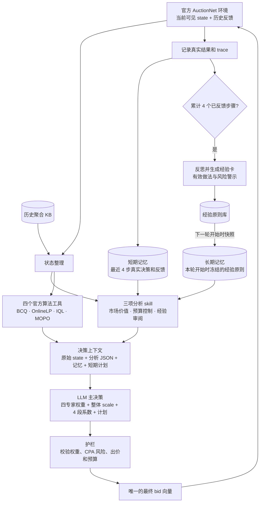

# AuctionNet Bidding Agent

这是一个在 AuctionNet 连续竞价环境中运行的竞价 Agent。它每个决策步读取当前广告主可见的状态和已发生的反馈，分析市场、预算与历史经验，取得四个官方算法的候选出价，再由 LLM 综合为一个出价向量。最终动作经过护栏后交给官方模拟器执行。

当前实现使用官方 **BCQ、OnlineLP、IQL、MOPO** 作为算法工具；其余广告主沿用 AuctionNet 官方策略和模型权重。Agent 的目标是官方 `beta=2` score，预算利用率只是诊断信息。

## Agent 结构



每一步都会调用三项分析 skill。它们在一次 LLM 请求中分别给出自然语言结论与结构化 JSON；数值指标由程序附加。四个官方算法各自根据同一份真实历史产生候选 bid。主 LLM 给四个候选分配权重，并可在限定范围内调整整体价格和四个 `pValue` 分段的价格，因此最终出价是逐 PV 融合后的结果。

短期记忆保存最近四步的实际动作与反馈，短期计划最多覆盖当前起四步并在每步重估。每四步产生一张广告主专属经验卡，保留正向建议和风险警示；本轮形成的原则要到下一轮才可检索，防止用尚未完成的经验影响同一轮。经验卡记录的是观察性反馈，不能把未执行算法的候选出价当成反事实收益。

护栏负责校验输出格式、非负归一化权重、整体与分段调价范围、CPA 风险以及剩余预算。模型或工具失败时会记录回退；预算耗尽后最终出价为零。原始决策、护栏后的动作、实际执行出价和反馈都有 trace。

## 代码位置

| 目录 | 作用 |
|---|---|
| `autobid_agent/` | Agent 决策循环、官方算法工具、输入输出契约、模型客户端、记忆与三个分析 skill |
| `compat/` | 当前运行所需的官方模拟器桥接、历史 KB 查询和基线适配；保留旧 GAVE 来源代码的兼容部分，当前 Agent 不加载 GAVE 权重 |
| `experiments/` | 竞价环境运行入口与结果汇总，独立于 Agent 核心 |
| `cache/` | 从历史竞价轨迹生成的聚合 KB，不含原始大体量数据 |
| `docs/` | [架构细节](docs/agent_design.md)与[独立流程图](docs/agent_architecture.mmd) |

## 本地运行

1. 在仓库根目录运行 `./setup_auctionnet.ps1`，取得固定版本的[官方 AuctionNet](https://github.com/alimama-tech/AuctionNet) 代码和权重。仓库固定到 `c20de631a40e24669d1d6a8e2acefd8f492f172d`；`third_party/AuctionNet/` 不上传到本仓库。
2. 准备 Python 3.9 环境，安装官方 `third_party/AuctionNet/requirements.txt` 所需依赖及 `openai`。根据本机 CPU/CUDA 环境安装合适的 PyTorch。
3. 设置百炼模型密钥并启动入口：

```powershell
$env:DASHSCOPE_API_KEY = '<your-key>'
python launch.py --output-dir outputs/my_run
```

当前入口使用 `qwen3.7-plus-2026-05-26`，需要相应模型权限并产生 LLM 调用费用。运行内容是 48 个广告主、每人一个冷启动 Episode 和一个读取上轮经验的 Episode；每轮还运行四个官方算法以便比较。运行中断后可使用同一输出目录续跑；若代码、KB 或官方版本改变，请改用新目录。日志、逐步出价和经验卡写入 `outputs/`，默认不会进入 Git。
